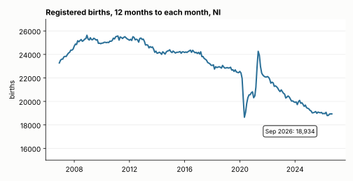
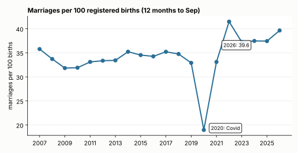
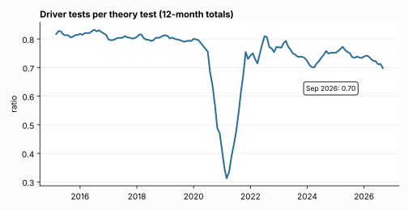
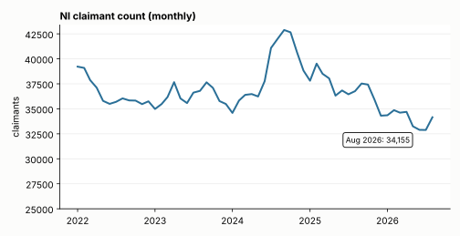

# Insights Digest - 2026-10-20

Scope: no `data_sources/` modules merged in the last 7 days; findings come from fresh releases of covered series (Monthly Births / Marriages / Stillbirths / Deaths September 2026, DVA Monthly Tests September 2026, NI Labour Market October 2026). All numbers were produced by code run on 2026-10-20 against live data.

## At a glance

| # | Metric | Latest | Comparator | Change | Confidence |
|---|--------|--------|------------|--------|------------|
| 1 | Registered births, 12 months to Sep | 18,934 (2026) | 19,091 (2025); 25,180 (2008); 22,683 (2019) | -0.8% y/y; -24.8% vs 2008; -16.5% vs 2019 | High |
| 2 | Marriages per 100 registered births, 12 months to Sep | 39.6 (2026) | 37.4 (2025); 32.9 (2019) | +2.2 pts y/y; marriages +5.0% y/y but only +0.6% vs 2019 | Medium |
| 3 | DVA driver tests per theory test, 12-month totals | 0.70 (Sep 2026) | 0.73 (Sep 2025); 0.79 (Sep 2019) | theory tests +9.4% y/y, driver tests +4.0% y/y | Medium |
| 4 | Employment rate (16+), Jun-Aug vs claimant count (Aug) | 58.7%; 34,155 claimants | 57.7%; 36,765 claimants (a year earlier) | +1.0 pt; -7.1% | Low-Medium |

## 1. Births keep falling: 12-month total is a quarter below 2008

| 12 months to Sep | Births (registered) |
|---|---|
| 2008 | 25,180 |
| 2019 | 22,683 |
| 2025 | 19,091 |
| 2026 | 18,934 |



```python
from bolster.data_sources.nisra import births
b = births.get_latest_births()["registration"]
b = b[b.sex == "Persons"].set_index("month").births
b12 = b.rolling(12).sum()
print(b12[b12.index.month == 9].loc[["2008-09-01", "2019-09-01", "2025-09-01", "2026-09-01"]])
```

Caveat: registration month, not birth month. The occurrence series lags by two months (latest 2026-07), so the like-for-like occurrence view is not yet available for September.
Confidence: High (full census of registrations; the y/y change is small, the long-run decline is large).

## 2. Marriages per birth at 39.6, but mostly because births fell

| 12 months to Sep | Marriages | Births | Marriages per 100 births |
|---|---|---|---|
| 2019 | 7,464 | 22,683 | 32.9 |
| 2022 | 8,812 | 21,243 | 41.5 |
| 2024 | 7,334 | 19,574 | 37.5 |
| 2025 | 7,146 | 19,091 | 37.4 |
| 2026 | 7,506 | 18,934 | 39.6 |



```python
from bolster.data_sources.nisra import births, marriages
b = births.get_latest_births()["registration"]; b = b[b.sex == "Persons"].set_index("month").births
m = marriages.get_latest_marriages().dropna(subset=["marriages"]).set_index("date").marriages
r = (m.rolling(12).sum() / b.rolling(12).sum() * 100)
print(r[r.index.month == 9].loc["2017":])
```

Caveat: the ratio is a descriptive proxy, not a rate: marriages and births are different populations and different years of life (couples marry years before or after births, and not all births are to married couples). The rise since 2019 is almost entirely the denominator (births -16.5%, which alone lifts 32.9 to about 39.4) with marriages only +0.6% vs 2019; 2022 (post-Covid catch-up) is higher still.
Confidence: Medium. The marriages count is registered marriages in NI; non-NI residents marrying here are included.

## 3. Theory tests are outpacing driver tests

| 12 months to Sep | Theory tests | Driver tests | Driver per theory |
|---|---|---|---|
| 2019 | 72,404 | 57,204 | 0.79 |
| 2023 | 88,395 | 65,213 | 0.74 |
| 2025 | 92,444 | 67,853 | 0.73 |
| 2026 | 101,157 | 70,595 | 0.70 |



```python
from bolster.data_sources import dva
dr = dva.get_latest_driver_tests().set_index("date"); th = dva.get_latest_theory_tests().set_index("date")
x = (dr.rolling_12_month_total / th.rolling_12_month_total).dropna()
print(x[x.index.month == 9].loc["2019":])
```

Caveat: tests conducted, not people or passes; a theory pass is valid for a limited window so practical tests follow with a lag, and the ratio can fall simply because the theory-test count is rising now (a pipeline building) rather than because practical capacity is short. Per-person and pass-rate data are not in the module. Associated with, not evidence of, a practical-test backlog.
Confidence: Medium. The ratio is the lowest since the 2021 Covid trough (previous post-Covid low 0.70 in early 2024).

## 4. Employment up, claimants down: same direction, different instruments

| Measure | Latest | A year earlier | Change |
|---|---|---|---|
| In employment (LFS, Jun-Aug) | 908,000 | 886,000 | +22,000 |
| Employment rate (16+) | 58.7% | 57.7% | +1.0 pt |
| Economically inactive | 618,000 | 626,000 | -8,000 |
| Unemployed (LFS) | 20,000 | 22,000 | -2,000 |
| Claimant count, NI (Aug) | 34,155 | 36,765 | -2,610 (-7.1%) |



```python
from bolster.data_sources.nisra import labour_market, claimant_count
lm = labour_market.get_latest_labour_market_overview().set_index("rolling_quarter")
print((lm.in_employment / lm.population_16plus * 100).loc[["Jun-Aug 2025", "Jun-Aug 2026"]])
c = claimant_count.get_latest_claimant_count()
print(c[c.geography == "Northern Ireland"].set_index("date").claimants_total.loc[["2025-08-01", "2026-08-01"]])
```

Caveat: LFS figures are survey estimates over a rolling 3-month window with sampling error that can be comparable to a +/-10k move; the claimant count is an administrative single-month count of people on out-of-work benefits (Universal Credit rules, not ILO unemployment). The windows do not align (Jun-Aug vs August) and the overview module only holds nine quarters, so there is no longer history here.
Confidence: Low-Medium (direction agrees across two independent sources; magnitudes are not comparable).

## Skipped sources

| Source | Reason |
|---|---|
| Security Situation Statistics, Experience of Crime (PSNI) | Not explored this run; no strong cross-dataset pairing identified in time |
| New-series entries from the feed classifier | Ignored per workflow (tracked as `data-source-candidate` issues) |

No source returned 403 in this run.

## Joins considered and rejected

| Join | Why rejected |
|---|---|
| Births (registered, 12m to Sep) vs deaths (weekly totals, 52 weeks to 25 Sep) as natural change (+1,446 in 2026, +1,308 in 2025) | Only two like-for-like years in the weekly deaths series (starts 2024-01); different window alignments (52 weeks vs calendar months); registration vs occurrence timing differs |
| Marriages vs civil partnerships (9 in Sep 2026) | Civil-partnership counts are too small and noisy (single digits per month) for a ratio |
| Claimant count by LGD vs LFS employment by LGD | Different geographic denominators and release vintages; LFS LGD estimates carry wide confidence intervals |
| DVA tests vs vehicle licensing / population | No licensing or age-band counts in the library; population denominators would be per-person and mix test categories |
