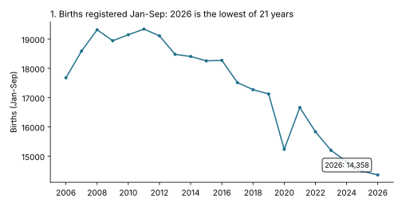
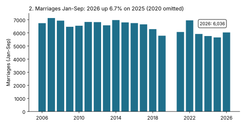
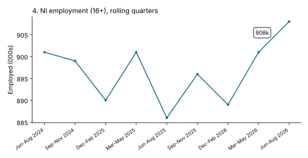

# Insights Digest - 2026-10-20

Draft for human review. Every number below was computed this run from live data via the `bolster` modules named in each snippet. Associations only, no causal claims.

## At a glance

| # | Metric | Latest | Comparator | Change | Confidence |
|---|--------|--------|------------|--------|------------|
| 1 | NI births registered, Jan-Sep | 14,358 (2026) | 17,124 (2019); 14,486 (2025) | -16.2% vs 2019; -0.9% vs 2025 | High |
| 2 | NI marriages, Jan-Sep | 6,036 (2026) | 5,655 (2025) | +6.7% | Medium |
| 3 | NI registered deaths, weeks 1-41 | 13,784 (2026) | 14,013 (2025) | -1.6%; 549 below 5-yr expected | Medium |
| 4 | NI employment (16+), Jun-Aug | 908k (2026) | 886k (2025) | +22k (+2.5%) | Low |

## 1. Births registered Jan-Sep 2026 are the lowest in the 21-year series

| Year | 2006 | 2011 | 2019 | 2021 | 2024 | 2025 | 2026 |
|------|------|------|------|------|------|------|------|
| Births, Jan-Sep (registration) | 17,677 | 19,339 | 17,124 | 16,662 | 14,811 | 14,486 | 14,358 |



```python
from bolster.data_sources.nisra import births
b = births.get_latest_births()["registration"]
b = b[(b.sex == "Persons") & (b.month.dt.month <= 9)]
print(b.groupby(b.month.dt.year).births.sum())
```

Caveat: registration-month counts, not occurrence-month, and Sep 2026 registrations may still be provisional; 2020 and 2021 were distorted by COVID registration closures.
Confidence: High that the series is at a low; the gap to 2025 (-128) is small.

## 2. Marriages Jan-Sep 2026 are up 6.7% on 2025

| Year | 2023 | 2024 | 2025 | 2026 |
|------|------|------|------|------|
| Marriages, Jan-Sep | 5,920 | 5,760 | 5,655 | 6,036 |

The gain is concentrated in March (427 vs 317 in 2025) and June (926 vs 839); July is 929 vs 832.



```python
from bolster.data_sources.nisra import marriages
m = marriages.get_latest_marriages().dropna()
print(m[m.date.dt.month <= 9].groupby("year").marriages.sum().tail(5))
```

Caveat: the March spike is unexplained here (month of Easter and booking timing differ each year); the monthly figures may be revised.
Confidence: Medium.

## 3. Registered deaths in 2026 are running below the five-year expectation

| Weeks 1-41 | Observed | Expected (5-yr) | Excess |
|------------|----------|-----------------|--------|
| 2024 | 14,049 | 14,350 | -301 |
| 2025 | 14,013 | 14,533 | -520 |
| 2026 | 13,784 | 14,333 | -549 |

```python
from bolster.data_sources.nisra import deaths
d = deaths.get_latest_deaths()["totals"]
d["y"] = d.week_ending.dt.year
print(d[d.week_number <= 41].groupby("y")[["observed_deaths", "expected_deaths_5yr", "excess_deaths_5yr"]].sum())
```

Caveat: weekly registration data (week ending 2 Jan to 9 Oct 2026), and the "expected" baseline moves each year as the five-year window rolls.
Confidence: Medium.

## 4. Employment is 22k higher than a year earlier, but within survey noise

| Rolling quarter | Jun-Aug 2025 | Dec-Feb 2026 | Mar-May 2026 | Jun-Aug 2026 |
|-----------------|--------------|--------------|--------------|--------------|
| In employment | 886k | 889k | 901k | 908k |
| 16+ population | 1,535k | 1,540k | 1,543k | 1,546k |



```python
from bolster.data_sources.nisra import labour_market as lm
print(lm.get_latest_labour_market_overview())
```

Caveat: Labour Force Survey estimates rounded to thousands, subject to sampling error not shown here; the series is volatile quarter to quarter (886k to 901k within a year).
Confidence: Low.

## Skipped sources

| Source | Reason |
|--------|--------|
| DVA monthly tests (Sep 2026) | Not explored this run |
| Weekly/monthly deaths, civil partnerships, CAMHS, crime, security situation | Not explored this run; no solid lead |

## Joins considered and rejected

| Join | Why rejected |
|------|--------------|
| Births (Jan-Sep calendar months) vs deaths (weeks 1-41 ending 2 Jan to 9 Oct) for natural change | Different windows (9 months vs 41 weeks); both registration-based, not occurrence; would give a misleading net figure |
| Births decline vs marriages rise (findings 1 and 2) | Opposite movements in the same year; births in a year mostly follow earlier marriages and parents are often unmarried, so the two do not measure the same population |
| Employment (16+ population base) vs births/deaths | Different geographies/definitions (LFS is survey-based household population); no crosswalk |
