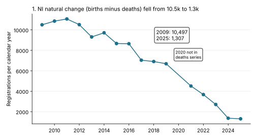
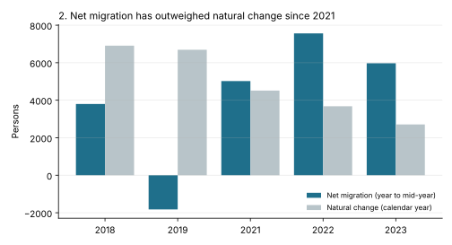
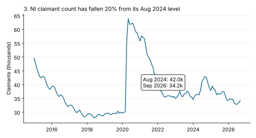

# Insights Digest - 2026-10-21

Draft for human review. All numbers were produced by code run on 2026-10-21 against live data; commands are at the end.

## At a glance

| # | Metric | Latest | Comparator | Change | Confidence |
|---|--------|--------|------------|--------|------------|
| 1 | NI natural change (registered births minus deaths), calendar year | 1,307 (2025) | 10,497 (2009) | -88% | High |
| 2 | Net migration vs natural change | 5,971 net migration (year from Jul 2023) vs 2,708 natural change (CY2023) | -1,822 vs 6,689 (2019 labels) | Migration now the larger term | Medium |
| 3 | NI claimant count | 34,225 (Sep 2026) | 42,000 (Aug 2024 peak since 2021) | -19% | High |
| 4 | Registered deaths, weeks 1-39 | 13,109 (2026) | 13,359 (2025) | -1.9% | Medium |

## 1. Births have fallen so far that natural change is near zero

Registered births fell every year bar 2021 since 2010, while registered deaths rose, so the gap has closed.



| Year | Births | Deaths | Natural change |
|------|-------:|-------:|---------------:|
| 2009 | 24,910 | 14,413 | 10,497 |
| 2015 | 24,215 | 15,548 | 8,667 |
| 2019 | 22,447 | 15,758 | 6,689 |
| 2023 | 19,962 | 17,254 | 2,708 |
| 2024 | 19,416 | 18,050 | 1,366 |
| 2025 | 19,062 | 17,755 | 1,307 |

Births Jan-Sep: 15,199 (2023), 14,811 (2024), 14,486 (2025), 14,358 (2026). The Jan-Sep 2026 fall is -0.9%, against -2.2% in 2025 and -2.6% in 2024, so the decline is slowing.

```python
from bolster.data_sources.nisra import births, deaths
b = births.get_latest_births()["registration"]; b = b[b.sex == "Persons"].set_index("month").births
print(b.groupby(b.index.year).sum())
print(deaths.get_historical_deaths().set_index("year").total_deaths)
```

Hypotheses: falling birth counts and an ageing population (more deaths) both contribute; the slowing of the births decline may mean natural change stabilises near 1,000-1,500 a year. Not tested against age-structure data here.

Caveat: 2020 is absent from the historical deaths series, so it is missing from the table. Births are by registration month, deaths by registration year; the 2025 weekly-deaths total (17,738) is within 0.1% of the annual series (17,755), which supports consistency.

Confidence: High.

## 2. Net migration now exceeds natural change

| Label year | Net migration | Natural change (same-label calendar year) |
|-----------:|--------------:|------------------------------------------:|
| 2018 | 3,799 | 6,907 |
| 2019 | -1,822 | 6,689 |
| 2021 | 5,020 | 4,513 |
| 2022 | 7,562 | 3,678 |
| 2023 | 5,971 | 2,708 |



```python
from bolster.data_sources.nisra import migration
print(migration.get_official_migration().tail(6))
```

Hypotheses: recent population growth is likely driven by migration rather than births minus deaths. This test is the join of finding 1 with the migration series; it holds directionally (2021 to 2023) but the periods are misaligned.

Caveat: migration `year` N covers the 12 months ending 30 June N+1 (the `date` column), while natural change is the calendar year N. They overlap by about half. Net migration has no 2024 or 2025 value yet, and 2020 is missing from deaths. This is a directional comparison, not an additive population bridge.

Confidence: Medium.

## 3. Claimant count has fallen about a fifth from its 2024 level

| Month | NI claimants | Rate |
|-------|-------------:|-----:|
| Aug 2019 | 29,590 | 2.5% |
| Aug 2023 | 36,795 | 3.1% |
| Aug 2024 | 42,000 | 3.5% |
| Aug 2025 | 36,765 | 3.1% |
| Aug 2026 | 33,515 | 2.8% |
| Sep 2026 | 34,225 | 2.9% |



The October 2026 Labour Market Report shows LFS unemployed of 20,000 for Jun-Aug 2026, down from 22,000 for Jun-Aug 2025 (-9%), and 17,000 for Mar-May 2026. The 3-month mean claimant count ending Aug fell from 36,685 to 33,098 (-10%) over the same year, so the two measures agree on direction.

```python
from bolster.data_sources.nisra import claimant_count, labour_market
c = claimant_count.get_latest_claimant_count()
print(c[c.geography == "Northern Ireland"].set_index("date").claimants_total.tail(14))
print(labour_market.get_latest_labour_market_overview())
```

Hypotheses: easing of benefit-claiming and a stronger labour market could both contribute; not tested. The jump to 42,000 in Aug 2024 may reflect a definitional or roll-out effect, which has not been investigated.

Caveat: claimants (benefit based, includes some in-work Universal Credit claimants) are not ILO unemployed (survey based, 16+); levels differ (34k vs 20k) and should not be compared as levels. LFS estimates are rounded to thousands and have sampling error of a similar order to the 2,000 change.

Confidence: High for the claimant trend, low for the LFS comparison.

## 4. Deaths running slightly below last year

| Weeks 1-39 | Registered deaths | Weeks 1-41 flu/pneumonia |
|-----------:|------------------:|-------------------------:|
| 2024 | 13,435 | 2,568 |
| 2025 | 13,359 | 2,516 |
| 2026 | 13,109 | 2,332 |

Week ending 9 Oct 2026: 321 observed against 330 expected (5-year average).

```python
from bolster.data_sources.nisra import deaths
t = deaths.get_latest_deaths()["totals"]
print(t[t.week_number <= 39].groupby(t.week_ending.dt.year).observed_deaths.sum())
```

Hypotheses: lower respiratory-related deaths (-7% on 2025) explain much of the dip; not tested further. Because deaths are below last year while births also fall, finding 1's gap may narrow only slowly in 2026.

Caveat: only three years of weekly data are in the weekly series (145 weeks), week numbering may differ across years by a day or two, and the flu/pneumonia counts include provisional registrations.

Confidence: Medium.

## Skipped sources

| Source | Reason |
|--------|--------|
| PSNI security situation, crime survey | Not pursued this run; no hypothesis formed |
| Fresh DVA, Marriages, Stillbirths monthly releases | Reviewed for scope only; no finding that held up |

## Joins considered and rejected

| Join | Why rejected |
|------|--------------|
| Births x population (rate per 1,000) | Population get function needs year/DataFrame arguments and is mid-year, not registration based; not verified |
| Claimants x LFS unemployed as levels | Different definitions and populations (see finding 3) |
| Net migration + natural change = population change | Overlapping but misaligned 12-month windows (finding 2) |

## Commands re-run

- `uv run scripts/nisra_feed_tfidf.py --limit 30 --json-out /tmp/drift.json`
- Disposable scripts calling `births.get_latest_births`, `deaths.get_latest_deaths`, `deaths.get_historical_deaths`, `migration.get_official_migration`, `claimant_count.get_latest_claimant_count`, `labour_market.get_latest_labour_market_overview`
- `uv run --with matplotlib` chart script
