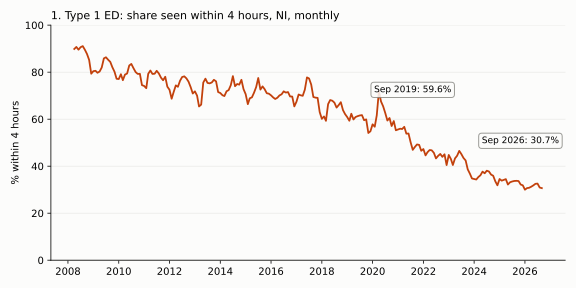
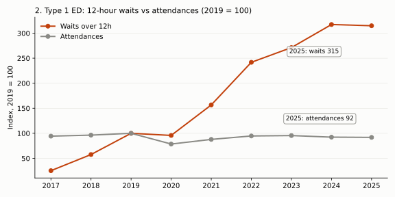

# Insights Digest - 2026-10-22

Data run live on 2026-10-22. Fresh releases this week paired with older modules: Emergency Care Waiting Times (Jul-Sep 2026), NI Labour Market (October 2026). Every number below was produced by the snippets shown, run in this session.

## At a glance

| # | Metric | Latest | Comparator | Change | Confidence |
|---|--------|--------|-----------|--------|------------|
| 1 | Type 1 ED patients seen within 4h (NI) | 30.7% (Sep 2026) | 59.6% (Sep 2019) | -28.9 pts | High |
| 2 | Type 1 ED waits over 12h, calendar year | 132,923 (2025) | 42,218 (2019) | x3.15, while attendances -8.2% | High (pattern), Low (explanation) |
| 3 | South Eastern Trust (Ulster) Type 1 within 4h | 14.2% (Sep 2026) | 59.8% (Sep 2019) | -45.6 pts; 36.7% wait over 12h | High |
| 4 | NI employment / claimant count | 908k (Jun-Aug 2026); 33.1k avg claimants | 886k; 36.7k (Jun-Aug 2025) | +22k; -9.8% | Medium-low |

## 1. Type 1 emergency department 4-hour performance sits at a record low, and the decline is not seasonal



| Type 1, all NI trusts, September | Attendances | Within 4h | Over 12h share |
|---|---|---|---|
| 2008 | 45,239 | 89.5% | 0.0% |
| 2019 | 57,548 | 59.6% | 6.0% |
| 2025 | 52,236 | 33.8% | 20.6% |
| 2026 | 56,049 | 30.7% | 22.9% |

The seasonal swing is small next to the trend: averaged over 2022-2025, the within-4h share ranges from 34.7% (December) to 40.6% (June), whereas it fell about 29 points between September 2019 and September 2026. September 2026 is the lowest September in the series (from April 2008).

```python
from bolster.data_sources.health_ni import emergency_care_waiting_times as ec
d = ec.get_latest_data(); d = d[d.attendance_type == "Type 1"]
g = d.groupby("date")[["under_4hrs", "over_12hrs", "total"]].sum()
g["p4"] = g.under_4hrs / g.total; g["p12"] = g.over_12hrs / g.total
print(g[g.index.month == 9][["total", "p4", "p12"]])
```

Hypotheses: a long, monotone slide that has persisted through 2008-2026 and across five trusts suggests a structural cause (flow out of hospital, workforce, case mix) rather than a one-off shock. Tested in Finding 2.

Caveat: a 4-hour target is measured on Type 1 (major) departments only here; Type 3 (minor injury units) are excluded and behave very differently.
Confidence: High.

## 2. Waits over 12 hours have tripled since 2019 while Type 1 attendances fell



| Type 1, calendar year | Attendances | Over 12h | NI population 65+ | NI population 75+ |
|---|---|---|---|---|
| 2019 | 685,858 | 42,218 | 316,946 | 144,087 |
| 2025 | 629,851 | 132,923 | 356,485 | 167,417 |
| Change | -8.2% | x3.15 | +12.5% | +16.2% |

```python
from bolster.data_sources.health_ni import emergency_care_waiting_times as ec
from bolster.data_sources.nisra import population as pop
d = ec.get_latest_data(); d = d[d.attendance_type == "Type 1"]
print(d.groupby("year")[["total", "over_12hrs"]].sum().loc[2017:2025])
p = pop.get_latest_population()
n = p[(p.area_name == "NORTHERN IRELAND") & (p.sex == "All persons")].drop_duplicates(["year", "age_5"])
print(n[n.age_5.isin(["65-69","70-74","75-79","80-84","85-89","90+"])].groupby("year").population.sum().loc[[2019, 2025]])
```

Hypotheses (not conclusions): (a) crude attendance volume does not explain the deterioration, since volume is lower; (b) an older population (65+ up 12.5%) may mean more complex attenders and longer stays, but the library has no attendance-by-age data, so this is untested; (c) downstream flow, such as inpatient bed availability, is the usual suspect. We tried to test (c) with `hospital_activity` acute bed occupancy joined to ED performance by calendar quarter. Result: null and unreliable. Acute occupancy was 84.3% (Mar-Dec 2019 quarters) and 82.7% (Mar-Sep 2023 quarters), essentially flat, while within-4h fell from about 60% to about 43%. Correlations across windows flip sign (corr of occupancy with within-4h share: +0.05 for 2016-Q2 to 2023-Q3, -0.88 for 2021-Q2 to 2023-Q3, n=10), so no relationship is supported.

Caveat: the hospital_activity join is invalid after 2023 (see rejected joins). Population is mid-year estimates; attendances are calendar-year Type 1 only. 2026 is a partial year and is excluded.
Confidence: High that the pattern holds in this data; Low on any explanation.

## 3. One department is far worse than the rest: Ulster Hospital, South Eastern Trust

| Type 1, Sep 2026 | Attendances | Within 4h | Over 12h share |
|---|---|---|---|
| RBHSC (paediatric) | 3,995 | 64.8% | 0.2% |
| Causeway | 4,458 | 42.2% | 15.6% |
| Craigavon Area | 7,574 | 30.3% | 26.4% |
| Altnagelvin Area | 5,003 | 25.3% | 25.7% |
| RVH | 7,125 | 14.2% | 30.7% |
| Ulster (South Eastern) | 7,035 | 14.2% | 36.7% |

Ulster over time: Sep 2019 59.8% within 4h (757 waits over 12h out of 8,270); Sep 2025 19.9% (2,146 of 6,961); Sep 2026 14.2% (2,585 of 7,035). South Eastern Trust Type 1 attendances in Sep 2026 were 15% below Sep 2019 (7,035 vs 8,270), yet over-12h waits rose 3.4x.

```python
d = ec.get_latest_data()
x = d[(d.date == "2026-09-01") & (d.attendance_type == "Type 1")].copy()
x["p12"] = x.over_12hrs / x.total
print(x[["trust", "dept", "total", "pct_within_4hrs", "p12"]].sort_values("p12"))
```

Hypotheses: with only 7,035 attendances, Ulster is mid-sized, so scale alone is not the explanation; local flow or staffing differences are candidates, but no library dataset is at hospital level for workforce, so this is untested.

Caveat: the trust-level hospital_activity data cannot be joined past 2023 (below). Department definitions may change between releases.
Confidence: High.

## 4. Labour market: employment and claimants both improving over the year, but on different yardsticks

| Rolling quarter | Employed | LFS unemployed | Inactivity rate | Avg claimants (same months) |
|---|---|---|---|---|
| Jun-Aug 2025 | 886,000 | 22,000 | 40.8% | 36,685 |
| Jun-Aug 2026 | 908,000 | 20,000 | 40.0% | 33,098 |

Claimants in September 2026 were 34,225 (rate 2.9%), still 16% above September 2019 (29,505), whereas LFS unemployment (2.2% of the economically active) is a different measure.

```python
from bolster.data_sources.nisra import claimant_count as cc, labour_market as lm
c = cc.get_latest_claimant_count(); ni = c[c.geography_code == "N92000002"].set_index("date")
print(ni.claimants_total.loc["2025-06-01":"2025-08-01"].mean(), ni.claimants_total.loc["2026-06-01":"2026-08-01"].mean())
print(lm.get_latest_labour_market_overview())
```

Hypotheses: falling claimants alongside rising employment is consistent with a tightening market, though LFS year-on-year moves of 2,000 in unemployment are within sampling noise. Employment growth did not coincide with ED performance improving (Findings 1-3 worsened over the same period); no link is suggested.

Caveat: LFS figures are rounded to thousands and the overview holds just nine rolling quarters; claimant count includes in-work Universal Credit claimants, so it is not unemployment.
Confidence: Medium-low.

## Skipped sources

| Source | Reason |
|---|---|
| Planning statistics (Apr-Jun 2026 release) | Module returns financial years to 2024/25 only; the new release is not reflected, so no fresh comparison is possible. |
| Daera waste, Police Ombudsman, DVA tests, security situation, monthly births/deaths/marriages | Fresh releases seen but not selected: no finding survived scrutiny in the time-box, nothing run. |
| Drift `new` entries (ASHE 2026, gambling, material footprint, racial equality) | No module to join; tracked as candidates by the workflow. |

No 403 responses were encountered.

## Joins considered and rejected

| Join | Why rejected |
|---|---|
| hospital_activity beds vs ED performance (quarterly) | Hospital coverage collapses: 42 hospitals reported in 2023-Q2 and 13 by 2025-Q1/Q2 (Acute average available beds 4,391 -> 1,141), so later quarters measure missing rows, not beds. Pre-collapse correlations flip sign. |
| ED Type 3 (minor injury) trends | Type 3 attendances roughly doubled (7,867 in Sep 2019, 16,648 in Sep 2026) because the set of reporting units changed; comparisons over time mix composition with performance. |
| Claimant count vs LFS unemployment (levels) | Different definitions (administrative incl. in-work UC vs ILO survey); only direction is comparable. |
| ED 12h waits vs labour-market series | No plausible mechanism and no shared geography or cadence; correlation would be coincidence of two trends. |
