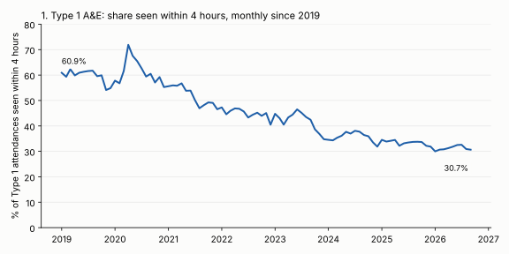
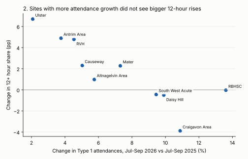
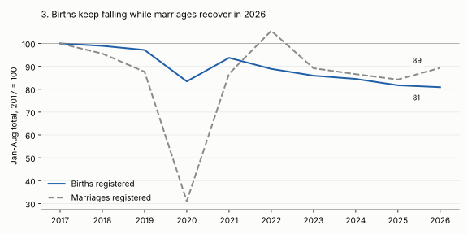

# Insights Digest - 2026-10-22

Data re-run live on 2026-10-22. Scope: modules with fresh releases in the last 7 days (emergency care Jul-Sep 2026, labour market Oct 2026, monthly births and marriages for September 2026, weekly deaths to 9 October 2026), paired with related modules in the library.

## At a glance

| # | Metric | Latest | Comparator | Change | Confidence |
|---|--------|--------|------------|--------|------------|
| 1 | Type 1 A&E seen within 4 hours (NI, Jul-Sep) | 31.4% | 33.7% (Jul-Sep 2025) | -2.3 pp | High |
| 2 | Site-level attendance growth vs change in 12+ hour share (10 sites, Jul-Sep) | r = -0.85 | n/a | no positive association | Medium-low |
| 3 | Births registered, Jan-Aug (NI) | 25,134 | 31,070 (2017) | -19.1% (-1.0% on 2025) | High |
| 3 | Marriages registered, Jan-Aug (NI) | 5,062 | 4,774 (2025) | +6.0% (-10.7% on 2017) | Medium |
| 4 | Employment rate, 16+ (Jun-Aug) | 58.7% | 57.7% (Jun-Aug 2025) | +1.0 pp | Low |

## 1. Type 1 A&E waits are still getting worse: fewer than a third seen in 4 hours, nearly 1 in 4 waits over 12 hours

| Period (Type 1, all 10 sites) | Attendances | Within 4h | Over 12h |
|---|---:|---:|---:|
| Sep 2019 | 57,548 | 59.6% | 6.0% |
| Sep 2022 | 54,692 | 45.2% | 16.1% |
| Sep 2024 | 51,635 | 36.4% | 21.5% |
| Sep 2025 | 52,236 | 33.8% | 20.6% |
| Sep 2026 | 56,049 | 30.7% | 22.9% |
| Jul-Sep 2024 | 154,286 | 37.4% | 20.6% |
| Jul-Sep 2025 | 156,436 | 33.7% | 20.7% |
| Jul-Sep 2026 | 166,747 | 31.4% | 22.6% |



```python
from bolster.data_sources.health_ni import emergency_care_waiting_times as ec
d = ec.get_latest_data(); t1 = d[d.attendance_type == "Type 1"]
m = t1.groupby("date")[["under_4hrs", "over_12hrs", "total"]].sum()
m["p4"] = m.under_4hrs / m.total; m["p12"] = m.over_12hrs / m.total
print(m[m.index.month == 9])
```

Hypotheses: demand growth (attendances +6.6% on Jul-Sep 2025) and a flow problem rather than a seasonal one. Check: the 12+ hour share was flat Jul-Sep 2024 to 2025 (20.6% to 20.7%) then rose 1.9 pp with attendances, so volume is consistent with the 2026 step; but see finding 2 for why volume alone does not explain it by site. Separately tested against weekly deaths (`deaths.get_latest_deaths()["totals"]`, 33 complete months from 2024): monthly 12+ hour share correlates r = 0.45 with mean weekly observed deaths and 0.41 with flu/pneumonia deaths (month-on-month differences: 0.50 and 0.45), mostly seasonal co-movement. In Aug-Sep 2026 weekly deaths (300.8, 320.0) and flu/pneumonia deaths (47.0, 48.5) were about the same as Aug-Sep 2025 (307.0, 328.0; 50.6, 46.8) while the 12+ hour share was higher (23.4%, 22.9% vs 20.5%, 20.6%). Mortality-linked seasonal demand does not explain this summer's deterioration.

Caveat: Type 1 only (consultant-led major departments); Type 2 (dental/specialty) has no 4-hour data in the latest month and Type 3 (minor injury) performs far better (76.2% within 4 hours in Sep 2026, unweighted mean across Type 3 sites), so an all-types figure would look better. The "total" is attendances, not unique patients.

Confidence: High on the direction (official counts, long series); the explanations are hypotheses.

## 2. Sites with the largest attendance growth did not see the largest rises in 12+ hour waits

Jul-Sep 2026 vs Jul-Sep 2025, Type 1:

| Trust | Site | Attendances 2026 | 2025 | Change | 12h+ share 2026 | 2025 | Change (pp) |
|---|---|---:|---:|---:|---:|---:|---:|
| Belfast | Mater | 11,660 | 10,866 | +7.3% | 16.9% | 14.7% | +2.3 |
| Belfast | RBHSC | 10,309 | 9,074 | +13.6% | 0.2% | 0.2% | 0.0 |
| Belfast | RVH | 21,522 | 20,588 | +4.5% | 31.0% | 26.2% | +4.8 |
| Northern | Antrim Area | 24,412 | 23,526 | +3.8% | 23.1% | 18.2% | +4.9 |
| Northern | Causeway | 13,852 | 13,188 | +5.0% | 16.4% | 14.1% | +2.3 |
| South Eastern | Ulster | 20,836 | 20,412 | +2.1% | 38.1% | 31.4% | +6.7 |
| Southern | Craigavon Area | 22,247 | 20,064 | +10.9% | 23.4% | 27.3% | -3.9 |
| Southern | Daisy Hill | 15,680 | 14,267 | +9.9% | 14.4% | 14.9% | -0.5 |
| Western | Altnagelvin Area | 15,237 | 14,408 | +5.8% | 25.0% | 24.0% | +1.0 |
| Western | South West Acute | 10,992 | 10,043 | +9.4% | 17.1% | 17.6% | -0.4 |



Correlation of attendance growth with change in 12+ hour share: r = -0.85 (10 sites), -0.94 excluding RBHSC (9 sites; RBHSC is the children's hospital and has almost no 12+ hour waits).

```python
# see finding 1 for t1; a = per-site Jul-Sep 2026 vs Jul-Sep 2025 aggregates
a["att"] = (a.total / a.total_py - 1) * 100; a["dp12"] = a.p12 - a.p12_py
print(a[["total", "total_py", "att", "p12", "p12_py", "dp12"]].round(1)); print(a.att.corr(a.dp12))
```

Hypotheses: the sites where waits worsened most (Ulster, Antrim, RVH) already had high baselines and the lowest demand growth, so the deterioration looks like a within-site capacity or discharge-flow effect, not a demand effect; the Southern Trust sites absorbed the largest increases while improving or holding. Not tested further here.

Caveat: ten points, one quarter, and a negative result that is partly a ceiling or baseline effect (sites already at 30%+ have different dynamics). Attendance counts by site do not account for service changes (e.g. redirected flows). No population or catchment denominators were joined.

Confidence: Medium-low. The null for "more volume means more long waits" is solid at this level; the negative sign is descriptive only.

## 3. Births keep falling while marriages recover in 2026

Jan-Aug totals (8 months complete in every year, registration basis):

| Year | Births registered | Marriages registered | Births (2017=100) | Marriages (2017=100) |
|---|---:|---:|---:|---:|
| 2017 | 31,070 | 5,667 | 100.0 | 100.0 |
| 2018 | 30,744 | 5,416 | 99.0 | 95.6 |
| 2019 | 30,188 | 4,967 | 97.2 | 87.6 |
| 2020 | 25,922 | 1,756 | 83.4 | 31.0 |
| 2021 | 29,118 | 4,915 | 93.7 | 86.7 |
| 2022 | 27,618 | 5,981 | 88.9 | 105.5 |
| 2023 | 26,696 | 5,054 | 85.9 | 89.2 |
| 2024 | 26,258 | 4,907 | 84.5 | 86.6 |
| 2025 | 25,392 | 4,774 | 81.7 | 84.2 |
| 2026 | 25,134 | 5,062 | 80.9 | 89.3 |



```python
from bolster.data_sources.nisra import births, marriages
b = births.get_latest_births()["registration"]; b["month"] = pd.to_datetime(b["month"])
bj = b[b.month.dt.month <= 8].groupby(b.month.dt.year).births.sum()
mm = marriages.get_latest_marriages().dropna()
mj = mm[mm.date.dt.month <= 8]
print(bj.loc[2017:], mj.groupby("year").marriages.sum().loc[2017:])
```

Hypotheses: births have declined every year since 2022 regardless of marriages; the post-pandemic 2022 marriage catch-up (+21.7% on 2021) was followed by a further birth decline in 2023 (-3.3%), which does not support a short-run marriage-to-birth link in these data. The 2026 marriage uptick (+6.0%) could reflect calendar effects (see caveat) rather than a trend.

Caveat: both series are by month of registration, not event date, and monthly births are summed across sexes. Marriage registrations include couples regardless of residence and are not a denominator for births (no age-specific fertility or population denominator is joined). Marriages 2026 is only 8 months of a recovering series; the library's marriage series also holds placeholder future months with no values, which were dropped here.

Confidence: High that births are down 19.1% on 2017 and 1.0% on 2025; medium that marriages are up 6.0%.

## 4. Employment rate up 1.0 pp on a year ago, but within survey noise

| Rolling quarter | Population 16+ | In employment | Unemployed | Inactive | Employment rate | Inactivity rate |
|---|---:|---:|---:|---:|---:|---:|
| Jun-Aug 2024 | 1,523,000 | 901,000 | 16,000 | 606,000 | 59.2% | 39.8% |
| Sep-Nov 2024 | 1,526,000 | 899,000 | 16,000 | 611,000 | 58.9% | 40.0% |
| Dec-Feb 2025 | 1,529,000 | 890,000 | 14,000 | 625,000 | 58.2% | 40.9% |
| Mar-May 2025 | 1,532,000 | 901,000 | 19,000 | 612,000 | 58.8% | 39.9% |
| Jun-Aug 2025 | 1,535,000 | 886,000 | 22,000 | 626,000 | 57.7% | 40.8% |
| Sep-Nov 2025 | 1,537,000 | 896,000 | 20,000 | 622,000 | 58.3% | 40.5% |
| Dec-Feb 2026 | 1,540,000 | 889,000 | 20,000 | 631,000 | 57.7% | 41.0% |
| Mar-May 2026 | 1,543,000 | 901,000 | 17,000 | 624,000 | 58.4% | 40.4% |
| Jun-Aug 2026 | 1,546,000 | 908,000 | 20,000 | 618,000 | 58.7% | 40.0% |

```python
from bolster.data_sources.nisra import labour_market as lm
o = lm.get_latest_labour_market_overview()
o["emp_rate"] = o.in_employment / o.population_16plus * 100; print(o)
```

Hypotheses: falling inactivity (626k to 618k) accounts for the rise, not falling unemployment (22k to 20k). Employment is still below Jun-Aug 2024 (59.2%).

Caveat: Labour Force Survey estimates are rounded to thousands and carry sampling error of the order of the 22,000 change, so this is a hint, not a trend. Rolling quarters overlap, so adjacent rows are not independent. Not joined to the A&E or births series; no relationship claimed.

Confidence: Low.

## Skipped sources

| Source | Reason |
|---|---|
| PSNI-hosted modules (police ombudsman, security situation) | Not explored this run; no 403 observed |
| Planning statistics, DAERA waste, DVA, ASHE, school leavers, GMS, elective waiting times | Fresh in scope but not explored this run |

## Joins considered and rejected

| Join | Why rejected |
|---|---|
| A&E 12+ hour share vs weekly deaths (used only as a hypothesis check in finding 1) | Weekly deaths (week ending Fridays, registrations) vs monthly attendance; only 33 overlapping months from 2024; seasonal confounding drives the positive correlation |
| Births vs marriages as cause/effect | Both by registration month; no age, parity or residence denominators; different populations |
| Births vs deaths (natural change) | Births monthly, deaths weekly; different dates (registration week vs month); no clean monthly crosswalk without recomputing weeks |
| Employment rate vs A&E demand | Different geographies and populations (LFS 16+ residents vs trust site attendances); no causal mechanism tested |

## Commands re-run

```
uv run scripts/nisra_feed_tfidf.py --limit 30 --json-out /tmp/drift.json
uv run python <scratch scripts calling the modules above>
```
