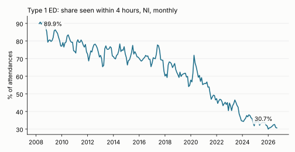
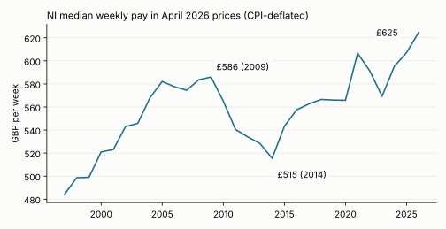
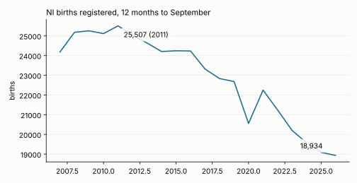

# Insights Digest - 2026-10-22

Draft for human review. All numbers were produced by code run on 2026-10-22 against live data (scripts in `scripts/build.py`).

## At a glance

| # | Metric | Latest | Comparator | Change | Confidence |
|---|--------|--------|------------|--------|------------|
| 1 | Type 1 ED attendances seen within 4 hours (NI) | 30.7% (Sep 2026) | 33.8% (Sep 2025); 89.5% (Sep 2008) | -3.1 pp YoY; -58.8 pp since 2008 | High |
| 1 | Type 1 ED attendances waiting over 12 hours | 22.9% (Sep 2026) | 20.6% (Sep 2025) | +2.3 pp YoY | High |
| 2 | NI median weekly pay, April 2026 prices | £624.7 (Apr 2026) | £607.1 (2025); £585.9 (2009 peak before the 2010s squeeze) | +2.9% real YoY; +6.6% vs 2009 | Medium |
| 3 | Births registered, 12 months to Sep | 18,934 (2026) | 19,091 (2025); 25,507 (2011) | -0.8% YoY; -25.8% vs 2011 | High |
| 3 | Marriages registered, 12 months to Sep | 7,506 (2026) | 7,146 (2025) | +5.0% YoY | Medium |

## 1. Emergency departments: the four-hour standard is now met for under a third of Type 1 attendances

Type 1 (consultant-led, 24-hour) attendances: 30.7% were seen within 4 hours in September 2026, and 22.9% waited over 12 hours. In September 2008 the figures were 89.5% and 0.0%.



| Sep | Type 1 attendances | Within 4h (%) | Over 12h (%) |
|-----|-------------------|---------------|--------------|
| 2008 | 45,239 | 89.5 | 0.0 |
| 2009 | 45,542 | 84.4 | 0.1 |
| 2010 | 47,084 | 80.0 | 0.6 |
| 2011 | 46,650 | 77.7 | 1.2 |
| 2012 | 45,390 | 77.3 | 0.6 |
| 2013 | 45,604 | 75.6 | 0.2 |
| 2014 | 48,506 | 75.0 | 0.5 |
| 2015 | 50,583 | 73.9 | 0.1 |
| 2016 | 52,714 | 71.5 | 0.3 |
| 2017 | 53,640 | 69.4 | 1.7 |
| 2018 | 54,147 | 66.0 | 3.2 |
| 2019 | 57,548 | 59.6 | 6.0 |
| 2020 | 48,757 | 60.5 | 8.6 |
| 2021 | 53,423 | 48.2 | 13.4 |
| 2022 | 54,692 | 45.2 | 16.1 |
| 2023 | 53,778 | 42.4 | 17.3 |
| 2024 | 51,635 | 36.4 | 21.5 |
| 2025 | 52,236 | 33.8 | 20.6 |
| 2026 | 56,049 | 30.7 | 22.9 |

By site, September 2026 versus September 2025 (Type 1):

| Department | Within 4h 2025 (%) | Within 4h 2026 (%) | Over 12h 2025 (%) | Over 12h 2026 (%) | Attendances 2026 |
|-----------|------|------|------|------|------|
| RVH | 17.3 | 14.2 | 26.0 | 30.7 | 7,125 |
| Ulster | 19.9 | 14.2 | 30.8 | 36.7 | 7,035 |
| Altnagelvin Area | 25.2 | 25.3 | 23.8 | 25.7 | 5,003 |
| Mater | 35.8 | 29.4 | 16.7 | 20.2 | 3,770 |
| Craigavon Area | 32.4 | 30.3 | 26.9 | 26.4 | 7,574 |
| Antrim Area | 33.6 | 31.0 | 19.6 | 21.9 | 8,218 |
| Daisy Hill | 40.9 | 39.0 | 14.1 | 16.8 | 5,183 |
| South West Acute | 42.9 | 39.6 | 16.0 | 16.7 | 3,688 |
| Causeway | 49.4 | 42.2 | 14.1 | 15.6 | 4,458 |
| RBHSC (children) | 71.7 | 64.8 | 0.1 | 0.2 | 3,995 |

```python
from bolster.data_sources.health_ni import emergency_care_waiting_times as ed
d = ed.get_latest_data(); t1 = d[d.attendance_type == "Type 1"]
g = t1.groupby("date")[["under_4hrs", "over_12hrs", "total"]].sum()
g["p4"] = g.under_4hrs / g.total * 100; g["o12"] = g.over_12hrs / g.total * 100
print(g[g.index.month == 9])
```

Hypotheses: the decline is steady rather than a recent shock (between -2.6 and -6.0 pp a year since September 2021), consistent with a capacity or flow problem rather than a demand spike, since September 2026 attendances (56,049, +7.3% YoY) are only 2.6% below the 2019 level (57,548) while the over-12h share is nearly four times higher. RVH and Ulster have the lowest four-hour figures (14.2% each); nine of ten departments fell YoY, Altnagelvin being flat. A follow-up test against hospital-side pressure (elective waiting lists) found no independent link: see "Joins considered and rejected".

Caveat: Type 1 only. Type 3 (minor injury/urgent care) is excluded because the `Craigavon & Daisy Hill UCCs` Type 3 rows carry a `total` but zero in every time band (1,496 attendances in Sep 2026, and in every month back to Dec 2025), so band totals do not sum to `total` for those rows. Attendances count each visit, not patients.

Confidence: High for the direction and size; the series is the department's own monthly publication.

## 2. Earnings: median weekly pay in NI is at a record in real terms

Median weekly gross pay (all employees) rose 5.8% to £624.7 in April 2026 (ASHE). UK CPI rose 2.8% over the same April-to-April window, so real median pay rose 2.9%, the third consecutive real rise (2024-2026) and a new high in the series (from 1997).



| ASHE year | Median weekly pay (£) | CPI index, April (2015=100) | Nominal YoY (%) | CPI YoY (%) | Real YoY (%) | Real pay, April 2026 prices (£) |
|-----|------|------|------|------|------|------|
| 2007 | 329.9 | 81.6 | 2.2 | 2.8 | -0.5 | 574.5 |
| 2008 | 345.0 | 84.0 | 4.6 | 2.9 | 1.6 | 583.6 |
| 2009 | 354.6 | 86.0 | 2.8 | 2.4 | 0.4 | 585.9 |
| 2010 | 354.7 | 89.2 | 0.0 | 3.7 | -3.6 | 565.1 |
| 2011 | 354.5 | 93.2 | -0.1 | 4.5 | -4.3 | 540.5 |
| 2012 | 360.8 | 96.0 | 1.8 | 3.0 | -1.2 | 534.1 |
| 2013 | 365.5 | 98.3 | 1.3 | 2.4 | -1.1 | 528.4 |
| 2014 | 363.1 | 100.1 | -0.7 | 1.8 | -2.4 | 515.4 |
| 2015 | 381.9 | 99.9 | 5.2 | -0.2 | 5.4 | 543.2 |
| 2016 | 393.1 | 100.2 | 2.9 | 0.3 | 2.6 | 557.5 |
| 2017 | 407.4 | 102.9 | 3.6 | 2.7 | 0.9 | 562.6 |
| 2018 | 420.2 | 105.4 | 3.1 | 2.4 | 0.7 | 566.5 |
| 2019 | 428.6 | 107.6 | 2.0 | 2.1 | -0.1 | 566.0 |
| 2020 | 432.0 | 108.5 | 0.8 | 0.8 | 0.0 | 565.8 |
| 2021 | 470.0 | 110.1 | 8.8 | 1.5 | 7.2 | 606.6 |
| 2022 | 499.2 | 120.0 | 6.2 | 9.0 | -2.5 | 591.1 |
| 2023 | 522.4 | 130.4 | 4.6 | 8.7 | -3.7 | 569.3 |
| 2024 | 559.2 | 133.5 | 7.0 | 2.4 | 4.6 | 595.2 |
| 2025 | 590.4 | 138.2 | 5.6 | 3.5 | 2.0 | 607.1 |
| 2026 | 624.7 | 142.1 | 5.8 | 2.8 | 2.9 | 624.7 |

Real median pay is 6.6% above 2009, 21.2% above the 2014 low, and 10.4% above 2019. Within 2026, full-time median pay rose 6.1% (£754.4) and part-time 3.9% (£281.3); female full-time rose 8.8% against 5.7% for male full-time.

```python
from bolster.data_sources import ons_cpi
from bolster.data_sources.nisra import ashe
c = ons_cpi.get_latest_data("monthly"); cpi = c[(c.series == "D7BT") & (c.month == 4)].set_index("year").value
a = ashe.get_latest_ashe_timeseries("weekly"); a = a[a.work_pattern == "All"].set_index("year").median_weekly_earnings
real = a / cpi * cpi.iloc[-1]
```

Hypotheses: a tight labour market could support pay. The LFS for June-August 2026 shows 908,000 in employment (+22,000 on 886,000 in June-August 2025) and 20,000 unemployed, and the April claimant rate is 2.9%. Tested across 2005-2026 (22 years), the April claimant rate and real pay growth are only weakly (negatively) related (r = -0.23; -0.52 for 2005-2019 only), so this period's strong real growth is not clearly explained by labour-market tightness alone. Minimum-wage and public-sector pay settlements were not testable with this library.

Caveat: ASHE is a survey of employee jobs with an April reference date and sampling error (the median coefficient of variation is about 1.2% for All, higher for sub-groups); the 2021 jump is partly composition from furlough. The CPI deflator is UK-wide (no NI CPI in the library), uses the April index, and CPI is not the household-specific price experience (housing costs are excluded from CPI, included in CPIH). The median mixes full- and part-time jobs, so shifts in the part-time share move it.

Confidence: Medium. The direction is robust to the choice of April CPI; the exact magnitude depends on the deflator.

## 3. Births keep falling while marriages ticked up

Births registered in the 12 months to September 2026 were 18,934, -0.8% on a year earlier and 25.8% below the 2011 peak (25,507). Registered marriages in the same window rose 5.0% to 7,506, the first annual increase since the post-pandemic catch-up peak in 2022.



| 12m to Sep | Marriages | Births | Marriages YoY (%) | Births YoY (%) |
|------|------|------|------|------|
| 2007 | 8,652 | 24,183 | | |
| 2008 | 8,489 | 25,180 | -1.9 | 4.1 |
| 2009 | 8,038 | 25,257 | -5.3 | 0.3 |
| 2010 | 8,012 | 25,114 | -0.3 | -0.6 |
| 2011 | 8,444 | 25,507 | 5.4 | 1.6 |
| 2012 | 8,353 | 25,043 | -1.1 | -1.8 |
| 2013 | 8,236 | 24,637 | -1.4 | -1.6 |
| 2014 | 8,526 | 24,205 | 3.5 | -1.8 |
| 2015 | 8,372 | 24,244 | -1.8 | 0.2 |
| 2016 | 8,303 | 24,233 | -0.8 | -0.0 |
| 2017 | 8,210 | 23,315 | -1.1 | -3.8 |
| 2018 | 7,936 | 22,833 | -3.3 | -2.1 |
| 2019 | 7,464 | 22,683 | -5.9 | -0.7 |
| 2020 | 3,899 | 20,556 | -47.8 | -9.4 |
| 2021 | 7,363 | 22,244 | 88.8 | 8.2 |
| 2022 | 8,812 | 21,243 | 19.7 | -4.5 |
| 2023 | 7,524 | 20,202 | -14.6 | -4.9 |
| 2024 | 7,334 | 19,574 | -2.5 | -3.1 |
| 2025 | 7,146 | 19,091 | -2.6 | -2.5 |
| 2026 | 7,506 | 18,934 | 5.0 | -0.8 |

```python
from bolster.data_sources.nisra import births, marriages
bb = births.get_latest_births()["registration"]; bb = bb[bb.sex == "Persons"].set_index("month").births
b12 = bb.rolling(12).sum(); print(b12[b12.index.month == 9])
mr = marriages.get_latest_marriages().set_index("date").marriages.dropna()
m12 = mr.rolling(12).sum(); print(m12[m12.index.month == 9])
```

Hypotheses: the slowdown in births has flattened (-4.5%, -4.9%, -3.1%, -2.5%, -0.8% over the last five years), which could mean the post-2022 fall is levelling out, or only that the 2026 window is noisy. Marriages and births moved together in annual changes (r = 0.76 over 2008-2026), but that is driven by the 2020-22 pandemic swings: excluding 2020-2022 it drops to r = 0.41 (n = 16), and marriage counts are already 0.6% above the 2019 level (7,506 vs 7,464) while births are 16.5% below it, so marriage is not a good predictor of the birth trend.

Caveat: counts are by registration date, not occurrence date, and the 2020 registration gap distorts 2020-21. The occurrence series ends in July 2026, so the headline uses registration. The births and marriages series are NI-wide with no age breakdown here, so changes in the number of women of childbearing age (population) are not separated from fertility; that was not tested in this run.

Confidence: High for the births trend; Medium for the marriages rise (one year, small change, near-recovery from a low base).

## Skipped sources

| Source | Reason |
|--------|--------|
| Police Ombudsman complaints, Q2 2026/27 | Not reached; time-boxed to the three findings above |
| Planning statistics Apr-Jun 2026, municipal waste Apr-Jun 2026, DVA tests Sep 2026, security situation | Fresh releases listed by the drift check but not analysed this run |
| Gambling licensing, material footprint, racial equality dashboard | `new` per the drift check; no existing module covers them (tracked as candidates, not analysed) |

No source returned a 403.

## Joins considered and rejected

| Join | Why rejected |
|------|--------------|
| ED over-12h share vs outpatient waits over 52 weeks (quarterly) | Levels correlate strongly (r = 0.84 for quarters from 2015) but both trend upward, and the correlation of 4-quarter changes is r = -0.26, so there is no evidence of a link beyond a shared trend. The elective series also switches from the legacy PAS to encompass sheets (`data_source`), the module output contains 610 duplicated key rows, and the `total` column repeats the row total on every band row, so it must not be summed across bands. Quarterly totals jump (e.g. outpatients 342,896 to 519,182 between June and September 2025), which looks like the system transition rather than real change. |
| LFS unemployment (20,000) vs claimant count (34,225) | Different definitions (ILO unemployed, rolling 3 months, versus benefit claimants including those in work on Universal Credit), different geography coverage and reference periods; the levels are not comparable. |
| ASHE median pay (NI) vs ONS CPI (UK) | Used for finding 2 as a deflator only; the geography mismatch (NI earnings, UK prices) and the April-only index are stated in the caveat. |
| Marriages vs births | Used in finding 3 as a null/weak association only; both on registration date but births follow marriages with a lag and are driven by many non-married births. |
